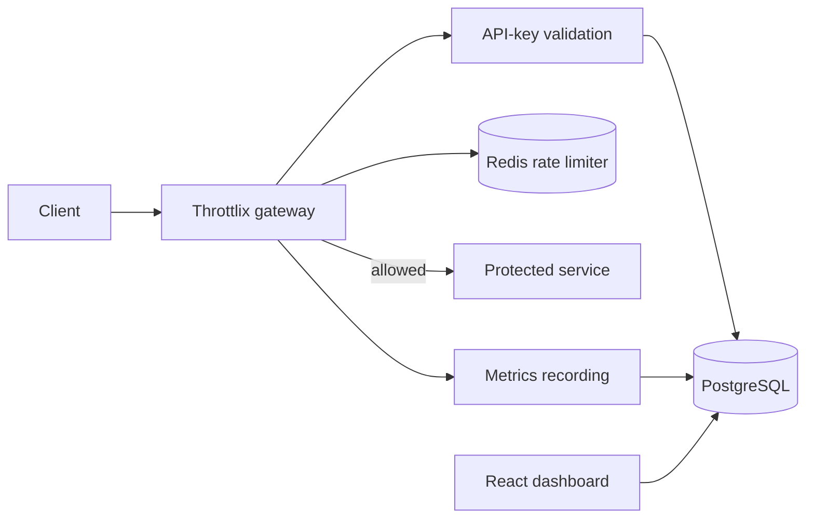

# Throttlix

**An API traffic-control layer designed to keep backend services responsive during bursts and abusive request patterns.**

## Overview

Throttlix is a planned API traffic-management platform that will sit in front of protected backend services. Its goal is to identify callers, apply request-rate policies before backend work begins, and make usage and rejection patterns visible to API owners.

It addresses a common operational problem: an integration bug, aggressive client, or sudden traffic surge can exhaust API capacity and degrade service for legitimate users. Throttlix provides a practical enforcement and observability layer for managing that risk.

## Planned Features

- API-key creation, management, and validation.
- Per-key fixed-window request limiting.
- Forwarding of allowed traffic to a protected service.
- Clear rejection responses, including HTTP `429 Too Many Requests` when a limit is exceeded.
- Persistent request-outcome metrics for operational analysis.
- A dashboard for request totals, allowed versus rejected traffic, active clients, and trends.

Potential later enhancements include queueing selected requests, anomaly alerts, configurable policies, and role-based administration.

## Intended Request Workflow

```text
Client request
  -> API-key validation
  -> rate-limit check
  -> allow: forward to protected service -> record metrics
  -> reject: return an authentication error or HTTP 429 -> record metrics
  -> dashboard reads aggregated metrics
```

## Intended Architecture



## Target Stack

| Technology | Intended role |
| --- | --- |
| Java 21 | Backend language. |
| Jakarta Servlets | Servlet-based web layer. |
| Apache Tomcat | Servlet container. |
| JDBC | Database access. |
| PostgreSQL | API-key metadata and durable metrics. |
| Redis | Fast rate-limit counters with expiry. |
| React + TypeScript | Dashboard application. |
| Tailwind CSS | Dashboard styling. |

Spring Boot is not part of the intended current implementation.

## Status

This repository is currently being initialized. Source code, configuration, API contracts, database migrations, and runnable setup instructions will be documented here once committed.
