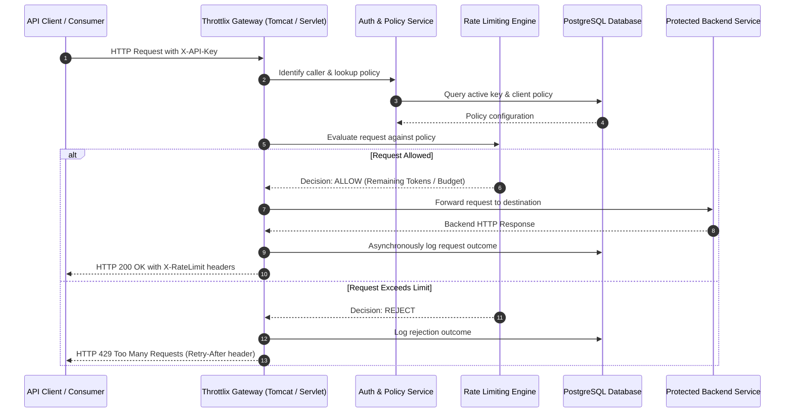

# Project Overview — Throttlix

## 1. Document Metadata
- **Project Name:** Throttlix — Intelligent API Traffic Management Platform
- **Document Version:** 1.0.0
- **Status:** Approved Baseline (Source: Project Handbook)
- **Primary Stakeholders:** Engineering Team, API Owners, System Administrators

---

## 2. Executive Summary
**Throttlix** is an intelligent API traffic management and rate limiting platform designed to operate as a lightweight traffic-control layer between external API consumers and protected backend services. It evaluates incoming HTTP requests in real time, validates client API credentials, applies configurable usage policies, permits allowed traffic, rejects excess requests with HTTP `429 Too Many Requests`, and records detailed metrics for operational observability.

---

## 3. Project Vision & Background
Modern applications frequently encounter sudden, unpredictable surges in API request volumes—such as flash sales, automated scrapers, buggy retry loops, or distributed denial-of-service attempts. Without an intelligent rate limiting and traffic-control boundary, backend services risk resource exhaustion, cascading service degradation, and total outage.

Throttlix provides a dedicated, lightweight, and deterministic traffic governance platform that guarantees fair capacity allocation, protects critical backend infrastructure, and provides operators with immediate visibility into consumption trends.

---

## 4. Problem Statement & Motivation
In unprotected backend environments:
1. **Resource Exhaustion:** Bursts of incoming traffic exhaust server CPU, memory, database connection pools, and thread capacity.
2. **The "Noisy Neighbor" Effect:** A single abusive client or faulty client-side loop consumes an unfair proportion of system bandwidth, starving legitimate callers.
3. **Operational Blindness:** Engineering teams lack granular, real-time insight into which API keys or endpoints generate traffic spikes or encounter recurring rejections.
4. **Rigid Policies:** Rate limits are often hardcoded into application endpoints, making policy updates cumbersome and prone to redeployment overhead.

---

## 5. Target Audience & Users
Throttlix is designed for:
- **API Owners & Service Providers:** Teams publishing public or internal REST APIs requiring fine-grained usage tiers.
- **Small-to-Medium Engineering Teams:** Development teams looking for a standalone, low-overhead traffic gateway without the complexity of heavy service-mesh architectures.
- **System Administrators & Operators:** Operations personnel requiring visibility into request volume, failure trends, and consumer usage patterns.

---

## 6. Proposed Solution & Core Workflow
Throttlix acts as an intermediary gateway processing requests through the following sequence:

---

## 7. Core Functionality (MVP Scope)
1. **API Key Lifecycle Management:** Generation, hashing, secure storage, and revocation of client API credentials.
2. **API Key Authentication:** Header-based (`X-API-Key`) client identification and status verification.
3. **Configurable Rate Limiting Algorithms:**
   - **Token Bucket Algorithm:** Accommodates legitimate short bursts while strictly regulating steady-state request velocity.
   - **Sliding Window Algorithm:** Enforces strict request volume caps over rolling time windows, eliminating boundary-burst vulnerabilities.
4. **Deterministic HTTP Response Handling:** Standards-compliant status codes (`200`, `400`, `401`, `403`, `429`, `500`) and standard rate-limiting response headers (`X-RateLimit-Limit`, `X-RateLimit-Remaining`, `X-RateLimit-Reset`, `Retry-After`).
5. **Durable Request Logging:** Relational persistence of request metadata and outcomes in PostgreSQL using raw JDBC.
6. **Observability Dashboard:** A modern React + TypeScript dashboard displaying traffic volume, allowed vs. rejected distributions, active keys, and latency graphs.

---

## 8. Expected Project Outcomes
- **Guaranteed System Stability:** Complete protection of downstream backend endpoints against volume-induced degradation.
- **Transparent Traffic Governance:** Clear, actionable feedback provided to client applications through standard HTTP headers and status codes.
- **Full Operational Observability:** Actionable telemetry allowing teams to identify traffic patterns, monitor consumption by tier, and adjust limits dynamically.
- **Clean Architectural Foundation:** A maintainable, modular codebase built on Core Java 21, Jakarta Servlets, JDBC, and PostgreSQL, designed to allow future scaling via distributed Redis counters.

