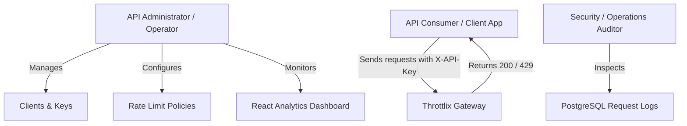

# User Roles & Personas — Throttlix

## 1. Role Architecture Overview
Throttlix establishes distinct operational roles to define access privileges, responsibilities, and system interactions across the platform.

---

## 2. Detailed Role Profiles

### 2.1 API Administrator / Platform Operator
- **Role Identifier:** `ROLE_ADMIN`
- **Description:** Technical personnel responsible for onboarding client applications, configuring traffic governance policies, and maintaining overall platform health.
- **Key Responsibilities:**
  - Create and manage client organization records.
  - Generate, inspect metadata for, and revoke client API keys.
  - Create, update, and assign rate-limiting policies (Token Bucket vs. Sliding Window, capacity, refill frequency).
  - Monitor aggregate traffic patterns, rejection rates, and system latency via the React dashboard.
- **Access Channels:**
  - Web Analytics Dashboard.
  - Administrative REST Endpoints (`/api/v1/clients`, `/api/v1/policies`, `/api/v1/keys`).

### 2.2 API Consumer / Client Application
- **Role Identifier:** `ROLE_CONSUMER`
- **Description:** External software applications, partner systems, frontend applications, or mobile clients that consume protected backend APIs through the Throttlix gateway.
- **Key Responsibilities:**
  - Securely store and transmit assigned API credentials in the `X-API-Key` HTTP request header.
  - Parse and respect standard rate-limit telemetry headers (`X-RateLimit-Limit`, `X-RateLimit-Remaining`, `X-RateLimit-Reset`).
  - Honor HTTP `429 Too Many Requests` responses and back off according to the `Retry-After` header value.
- **Access Channels:**
  - Protected Gateway Endpoints (e.g., `/api/v1/demo/*`, `/api/v1/protected/*`).

### 2.3 System Auditor / Operations Reviewer
- **Role Identifier:** `ROLE_AUDITOR`
- **Description:** Internal engineering or security team members conducting compliance audits, investigating abusive traffic spikes, or analyzing system capacity requirements.
- **Key Responsibilities:**
  - Review historical request logs in PostgreSQL to trace usage patterns.
  - Verify that sensitive credentials and request payloads are properly omitted from logs.
  - Assess client quota utilization to recommend tier upgrades or policy re-configurations.
- **Access Channels:**
  - Read-only database access to `request_logs`.
  - Analytics summary API endpoints (`/api/v1/analytics/*`).

---

## 3. Role Permission Matrix

| Operation / Capability | Administrator | API Consumer | Operations Auditor |
| :--- | :---: | :---: | :---: |
| Create / Deactivate Client Organizations | Yes | No | No |
| Generate & Revoke API Keys | Yes | No | No |
| Create & Assign Rate Limit Policies | Yes | No | No |
| Access Protected Backend Endpoints | No | Yes (via Key) | No |
| Read Rate-Limit Telemetry Headers | Yes | Yes | Yes |
| View Aggregate Dashboard Analytics | Yes | No | Yes (Read-Only) |
| Inspect Historical Request Audit Logs | Yes | No | Yes (Read-Only) |
| Read Raw API Key Plaintext | Once (at creation) | Possessed | No (Hashed only) |
