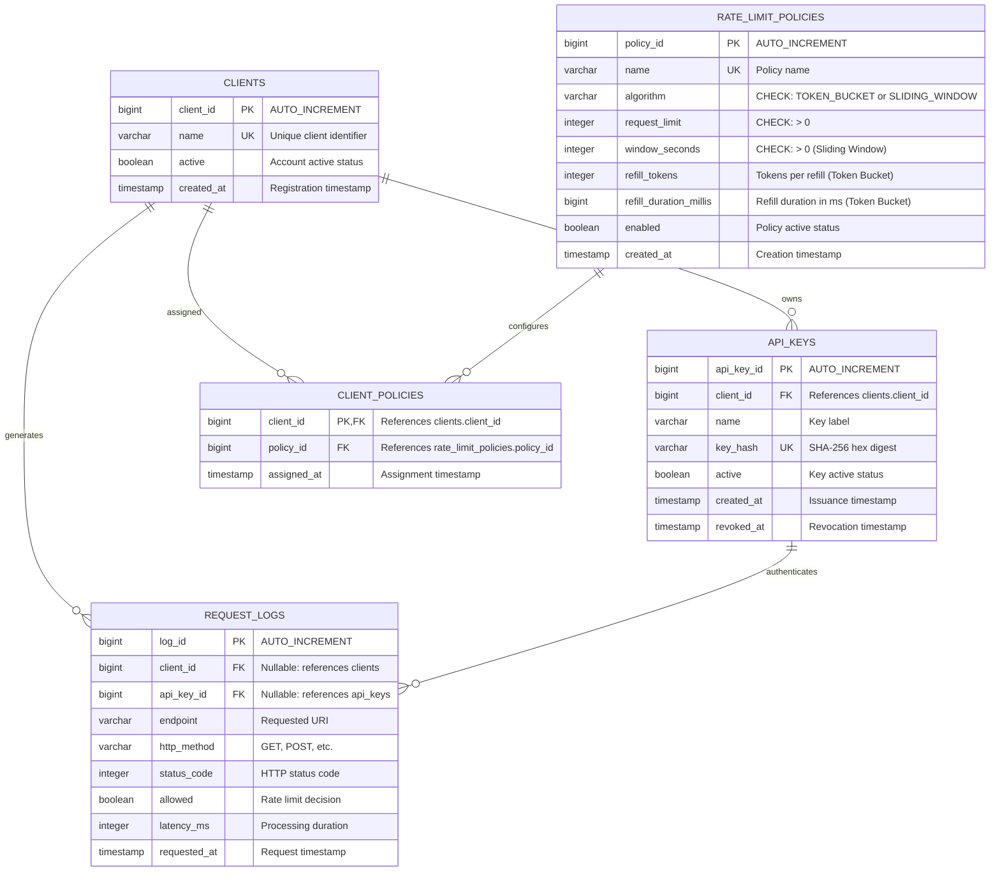

# Database Design & Schema — Throttlix

## 1. Overview & Technology Selection
**Throttlix** utilizes a relational database management system as its primary persistent relational datastore. The application supports **MySQL 8.x** (with historical design foundation in **PostgreSQL 15+**). The relational schema provides robust transactional guarantees (ACID), strong foreign key constraints, high-performance indexing, and native timestamp handling essential for high-velocity API request logging and administrative configuration.

Connection management and database queries are executed directly through **native JDBC** (`java.sql.PreparedStatement`, `java.sql.Connection`) using the official **MySQL Connector/J** driver (`com.mysql.cj.jdbc.Driver`) without the overhead of an Object-Relational Mapping (ORM) framework.

- **Target Database:** MySQL 8.x (`throttlix`)
- **Default Storage Engine:** `InnoDB` (for row-level locking, crash recovery, and foreign key enforcement)
- **Default Character Set:** `utf8mb4` with collation `utf8mb4_unicode_ci`

---

## 2. Entity-Relationship (ER) Diagram



---

## 3. Relational Schema & Table Definitions (MySQL 8.x)

The MySQL 8.x DDL is stored in [`database/mysql-schema.sql`](file:///c:/Users/prach/OneDrive/Desktop/Projects/Throttlix/Throttlix/database/mysql-schema.sql).

### 3.1 `clients` Table
Stores unique client organizations or developers registered to consume protected services.

```sql
CREATE TABLE IF NOT EXISTS clients (
    client_id   BIGINT NOT NULL AUTO_INCREMENT,
    name        VARCHAR(100) NOT NULL,
    active      BOOLEAN NOT NULL DEFAULT TRUE,
    created_at  TIMESTAMP NOT NULL DEFAULT CURRENT_TIMESTAMP,
    CONSTRAINT pk_clients PRIMARY KEY (client_id),
    CONSTRAINT uk_clients_name UNIQUE (name)
) ENGINE=InnoDB DEFAULT CHARSET=utf8mb4 COLLATE=utf8mb4_unicode_ci;
```

### 3.2 `api_keys` Table
Stores metadata and one-way cryptographic hashes (SHA-256) of client credentials. Raw secrets are never stored. Supports active, rotating, and revoked keys.

```sql
CREATE TABLE IF NOT EXISTS api_keys (
    api_key_id  BIGINT NOT NULL AUTO_INCREMENT,
    client_id   BIGINT NOT NULL,
    name        VARCHAR(100) NOT NULL,
    key_hash    VARCHAR(64) NOT NULL,
    active      BOOLEAN NOT NULL DEFAULT TRUE,
    created_at  TIMESTAMP NOT NULL DEFAULT CURRENT_TIMESTAMP,
    revoked_at  TIMESTAMP NULL DEFAULT NULL,
    CONSTRAINT pk_api_keys PRIMARY KEY (api_key_id),
    CONSTRAINT uk_api_keys_hash UNIQUE (key_hash),
    CONSTRAINT fk_api_keys_client FOREIGN KEY (client_id)
        REFERENCES clients (client_id) ON DELETE CASCADE,
    INDEX idx_api_keys_hash_active (key_hash, active),
    INDEX idx_api_keys_client_id (client_id)
) ENGINE=InnoDB DEFAULT CHARSET=utf8mb4 COLLATE=utf8mb4_unicode_ci;
```

### 3.3 `rate_limit_policies` Table
Defines reusable traffic-control configurations supporting both `TOKEN_BUCKET` and `SLIDING_WINDOW`.

```sql
CREATE TABLE IF NOT EXISTS rate_limit_policies (
    policy_id               BIGINT NOT NULL AUTO_INCREMENT,
    name                    VARCHAR(100) NOT NULL,
    algorithm               VARCHAR(30) NOT NULL,
    request_limit           INT NOT NULL,
    window_seconds          INT NOT NULL,
    refill_tokens           INT NULL DEFAULT NULL,
    refill_duration_millis  BIGINT NULL DEFAULT NULL,
    enabled                 BOOLEAN NOT NULL DEFAULT TRUE,
    created_at              TIMESTAMP NOT NULL DEFAULT CURRENT_TIMESTAMP,
    CONSTRAINT pk_rate_limit_policies PRIMARY KEY (policy_id),
    CONSTRAINT uk_rate_limit_policies_name UNIQUE (name),
    CONSTRAINT chk_policy_algorithm CHECK (algorithm IN ('TOKEN_BUCKET', 'SLIDING_WINDOW')),
    CONSTRAINT chk_policy_request_limit CHECK (request_limit > 0),
    CONSTRAINT chk_policy_window_seconds CHECK (window_seconds > 0)
) ENGINE=InnoDB DEFAULT CHARSET=utf8mb4 COLLATE=utf8mb4_unicode_ci;
```

### 3.4 `client_policies` Table
Junction table linking each client account to its active rate-limiting policy.

```sql
CREATE TABLE IF NOT EXISTS client_policies (
    client_id    BIGINT NOT NULL,
    policy_id    BIGINT NOT NULL,
    assigned_at  TIMESTAMP NOT NULL DEFAULT CURRENT_TIMESTAMP,
    CONSTRAINT pk_client_policies PRIMARY KEY (client_id),
    CONSTRAINT fk_client_policies_client FOREIGN KEY (client_id)
        REFERENCES clients (client_id) ON DELETE CASCADE,
    CONSTRAINT fk_client_policies_policy FOREIGN KEY (policy_id)
        REFERENCES rate_limit_policies (policy_id) ON DELETE RESTRICT,
    INDEX idx_client_policies_policy_id (policy_id)
) ENGINE=InnoDB DEFAULT CHARSET=utf8mb4 COLLATE=utf8mb4_unicode_ci;
```

### 3.5 `request_logs` Table
Append-only log recording every request processed by the gateway.

```sql
CREATE TABLE IF NOT EXISTS request_logs (
    log_id        BIGINT NOT NULL AUTO_INCREMENT,
    client_id     BIGINT NULL DEFAULT NULL,
    api_key_id    BIGINT NULL DEFAULT NULL,
    endpoint      VARCHAR(255) NOT NULL,
    http_method   VARCHAR(10) NOT NULL,
    status_code   INT NOT NULL,
    allowed       BOOLEAN NOT NULL,
    latency_ms    INT NOT NULL,
    requested_at  TIMESTAMP NOT NULL DEFAULT CURRENT_TIMESTAMP,
    CONSTRAINT pk_request_logs PRIMARY KEY (log_id),
    CONSTRAINT fk_request_logs_client FOREIGN KEY (client_id)
        REFERENCES clients (client_id) ON DELETE SET NULL,
    CONSTRAINT fk_request_logs_api_key FOREIGN KEY (api_key_id)
        REFERENCES api_keys (api_key_id) ON DELETE SET NULL,
    INDEX idx_request_logs_client_time (client_id, requested_at DESC),
    INDEX idx_request_logs_analytics (requested_at DESC, allowed)
) ENGINE=InnoDB DEFAULT CHARSET=utf8mb4 COLLATE=utf8mb4_unicode_ci;
```

---

## 4. PostgreSQL to MySQL 8.x Migration Mapping (History & Compatibility)

The project originally designed its schema targeting PostgreSQL 15+ ([`database/schema.sql`](file:///c:/Users/prach/OneDrive/Desktop/Projects/Throttlix/Throttlix/database/schema.sql)). The table below records how each PostgreSQL construct is translated to MySQL 8.x:

| Database Element | PostgreSQL 15+ (Historical) | MySQL 8.x (Active) | Reason for Adaptation |
|---|---|---|---|
| **Identity / Auto-increment** | `BIGSERIAL PRIMARY KEY` | `BIGINT NOT NULL AUTO_INCREMENT PRIMARY KEY` | MySQL utilizes `AUTO_INCREMENT` attribute on integer primary keys instead of PostgreSQL sequences. |
| **Timestamps with Timezone** | `TIMESTAMPTZ` | `TIMESTAMP` | MySQL `TIMESTAMP` automatically converts stored values to UTC and converts to connection session timezone upon retrieval. |
| **Boolean Data Type** | Native `BOOLEAN` (`true`/`false`) | `BOOLEAN` (alias for `TINYINT(1)`) | Compatible with JDBC `resultSet.getBoolean()`. |
| **Partial Indexes** | `CREATE INDEX ... WHERE active = TRUE` | Composite Index: `(key_hash, active)` | MySQL does not support partial indexed `WHERE` predicates; composite indexing achieves index-only scans for active key verification. |
| **Foreign Key Syntax** | Inline `REFERENCES table(col)` | Table-level `CONSTRAINT ... FOREIGN KEY ... REFERENCES` | Required in MySQL to enforce referential integrity under InnoDB. |
| **Descending Indexes** | `requested_at DESC` | `requested_at DESC` | Supported natively in MySQL 8.0+. |
| **Check Constraints** | `CHECK (...)` | `CONSTRAINT ... CHECK (...)` | Supported natively in MySQL 8.0.16+. |
| **Storage Engine** | Table default (Postgres heaps) | Explicit `ENGINE=InnoDB` | Enforces ACID compliance, crash safety, and row-level locking. |

---

## 5. Normalization Analysis

| Form | Compliance Details |
| :--- | :--- |
| **First Normal Form (1NF)** | All table attributes are atomic. No multi-valued attributes, repeating groups, or array columns used for core relational links. |
| **Second Normal Form (2NF)** | All non-key attributes are fully functionally dependent on their table's primary key. In `client_policies`, `assigned_at` depends completely on the composite key/client. |
| **Third Normal Form (3NF)** | No transitive functional dependencies exist. Client attributes remain in `clients`, policy rules remain in `rate_limit_policies`, eliminating modification anomalies. |

---

## 6. Performance, Indexing & Data Archival
1. **High-Frequency Lookups:** `idx_api_keys_hash_active` on `(key_hash, active)` enables indexed B-Tree lookup for incoming `X-API-Key` SHA-256 hashes on every request in $< 1\text{ms}$.
2. **Policy Junction Lookups:** `idx_client_policies_policy_id` supports reverse lookups when modifying or disabling a rate-limiting policy.
3. **Analytics Query Optimization:** `idx_request_logs_client_time` on `(client_id, requested_at DESC)` accelerates client-filtered analytics queries in the dashboard without full table scans.
4. **Partitioning Strategy (Post-MVP):** `request_logs` can be partitioned by range (`PARTITION BY RANGE (UNIX_TIMESTAMP(requested_at))`) as historical volume accumulates, enabling partition pruning and vacuuming.
