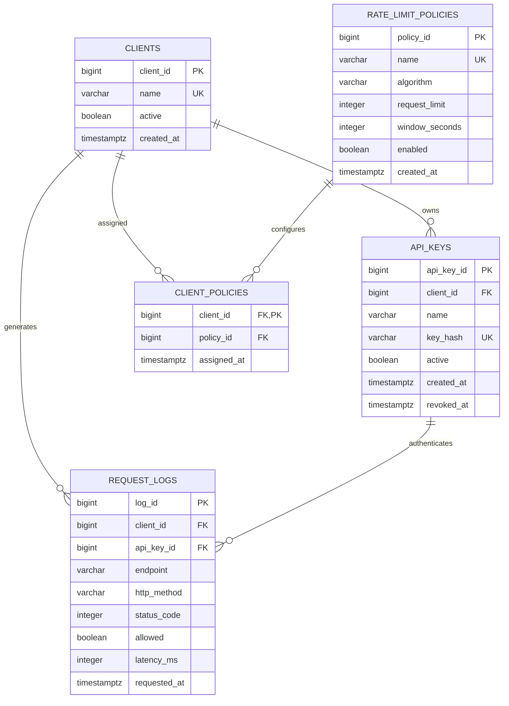

# Database Design & Schema — Throttlix

## 1. Overview & Technology Selection
**Throttlix** utilizes **PostgreSQL 15+** as its primary persistent relational datastore. PostgreSQL provides robust transactional guarantees (ACID), strong foreign key constraints, high-performance indexing, and native timestamp handling essential for high-velocity API request logging and administrative configuration.

Connection management and database queries are executed directly through **native JDBC** (`java.sql.PreparedStatement`, `java.sql.Connection`) without the overhead of an Object-Relational Mapping (ORM) framework.

---

## 2. Entity-Relationship (ER) Diagram



---

## 3. Relational Schema & Table Definitions

### 3.1 `clients` Table
Stores unique client organizations or developers registered to consume protected services.

```sql
CREATE TABLE clients (
    client_id BIGSERIAL PRIMARY KEY,
    name VARCHAR(100) NOT NULL UNIQUE,
    active BOOLEAN NOT NULL DEFAULT TRUE,
    created_at TIMESTAMPTZ NOT NULL DEFAULT CURRENT_TIMESTAMP
);
```

### 3.2 `api_keys` Table
Stores metadata and one-way cryptographic hashes (SHA-256) of client credentials. Raw secrets are never stored.

```sql
CREATE TABLE api_keys (
    api_key_id BIGSERIAL PRIMARY KEY,
    client_id BIGINT NOT NULL REFERENCES clients(client_id) ON DELETE CASCADE,
    name VARCHAR(100) NOT NULL,
    key_hash VARCHAR(64) NOT NULL UNIQUE,
    active BOOLEAN NOT NULL DEFAULT TRUE,
    created_at TIMESTAMPTZ NOT NULL DEFAULT CURRENT_TIMESTAMP,
    revoked_at TIMESTAMPTZ
);

CREATE INDEX idx_api_keys_hash ON api_keys(key_hash) WHERE active = TRUE;
```

### 3.3 `rate_limit_policies` Table
Defines reusable traffic-control configurations.

```sql
CREATE TABLE rate_limit_policies (
    policy_id BIGSERIAL PRIMARY KEY,
    name VARCHAR(100) NOT NULL UNIQUE,
    algorithm VARCHAR(30) NOT NULL CHECK (algorithm IN ('TOKEN_BUCKET', 'SLIDING_WINDOW')),
    request_limit INTEGER NOT NULL CHECK (request_limit > 0),
    window_seconds INTEGER NOT NULL CHECK (window_seconds > 0),
    enabled BOOLEAN NOT NULL DEFAULT TRUE,
    created_at TIMESTAMPTZ NOT NULL DEFAULT CURRENT_TIMESTAMP
);
```

### 3.4 `client_policies` Table
Junction table linking each client to an active rate-limiting policy.

```sql
CREATE TABLE client_policies (
    client_id BIGINT PRIMARY KEY REFERENCES clients(client_id) ON DELETE CASCADE,
    policy_id BIGINT NOT NULL REFERENCES rate_limit_policies(policy_id) ON DELETE RESTRICT,
    assigned_at TIMESTAMPTZ NOT NULL DEFAULT CURRENT_TIMESTAMP
);
```

### 3.5 `request_logs` Table
Append-only log recording every request processed by the gateway.

```sql
CREATE TABLE request_logs (
    log_id BIGSERIAL PRIMARY KEY,
    client_id BIGINT REFERENCES clients(client_id) ON DELETE SET NULL,
    api_key_id BIGINT REFERENCES api_keys(api_key_id) ON DELETE SET NULL,
    endpoint VARCHAR(255) NOT NULL,
    http_method VARCHAR(10) NOT NULL,
    status_code INTEGER NOT NULL,
    allowed BOOLEAN NOT NULL,
    latency_ms INTEGER NOT NULL,
    requested_at TIMESTAMPTZ NOT NULL DEFAULT CURRENT_TIMESTAMP
);

CREATE INDEX idx_request_logs_client_time 
    ON request_logs (client_id, requested_at DESC);

CREATE INDEX idx_request_logs_analytics 
    ON request_logs (requested_at DESC, allowed);
```

---

## 4. Normalization Analysis

| Form | Compliance Details |
| :--- | :--- |
| **First Normal Form (1NF)** | All table attributes are atomic. No multi-valued attributes, repeating groups, or array columns used for core relational links. |
| **Second Normal Form (2NF)** | All non-key attributes are fully functionally dependent on their table's primary key. In `client_policies`, `assigned_at` depends completely on the composite key/client. |
| **Third Normal Form (3NF)** | No transitive functional dependencies exist. Client attributes remain in `clients`, policy rules remain in `rate_limit_policies`, eliminating modification anomalies. |

---

## 5. Performance, Indexing & Data Archival
1. **High-Frequency Lookups:** `idx_api_keys_hash` allows $O(1)$ indexed B-Tree lookup for incoming `X-API-Key` hashes on every request.
2. **Analytics Query Optimization:** `idx_request_logs_client_time` accelerates client-filtered analytics queries in the dashboard without full table scans.
3. **Partitioning Strategy (Post-MVP):** `request_logs` can be partitioned by month (`RANGE (requested_at)`) as historical volume accumulates, enabling efficient archival and vacuuming.
