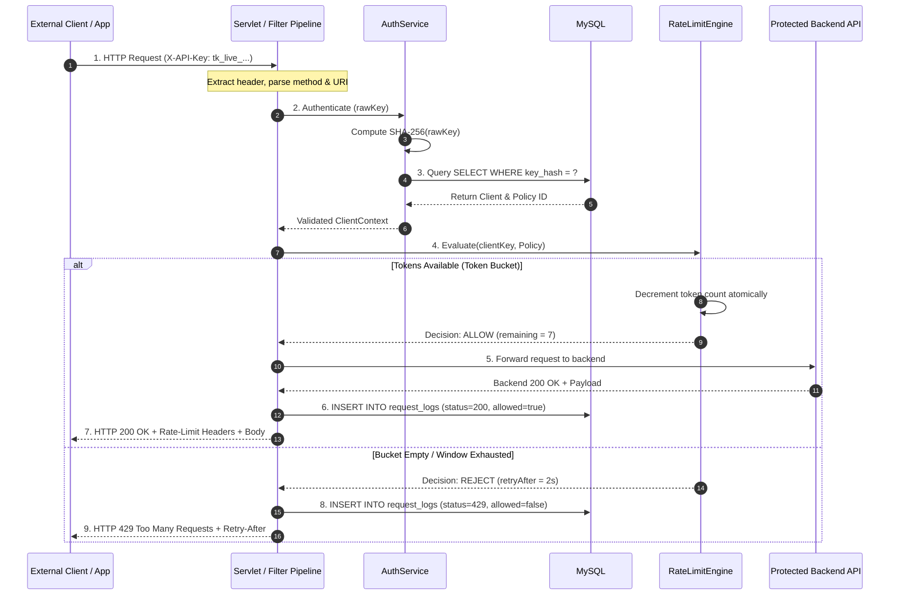
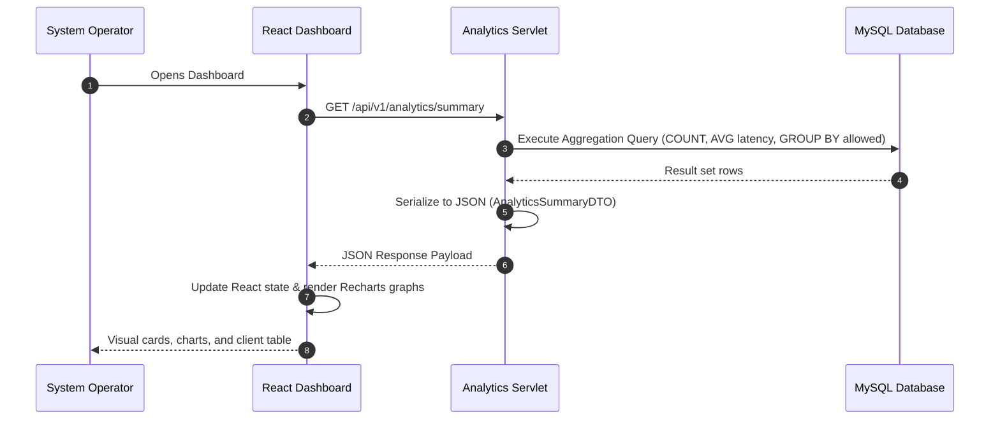

# Data Flow & Execution Pipelines — Throttlix

## 1. Overview
This document traces the path of data across all components of **Throttlix**, detailing ingress payload transformation, internal service interaction, state updates, and telemetry persistence.

---

## 2. Ingress Traffic Pipeline

---

## 3. Data Transformation at Each Boundary

| Pipeline Stage | Input Data Format | Output Data Format | Transformation Logic |
| :--- | :--- | :--- | :--- |
| **Ingress Header Extraction** | Raw HTTP Request stream | Extracted `X-API-Key` string | Null-check and alphanumeric character validation. |
| **Authentication Hashing** | Plaintext Key (e.g. `tk_live_...`) | 64-character Hex SHA-256 Digest | `MessageDigest.getInstance("SHA-256")`. |
| **Policy Resolution** | Client ID integer | `RateLimitPolicy` Java Object | Cache lookup or SQL read from `rate_limit_policies`. |
| **Algorithm Evaluation** | `(storedTokens, lastRefillTimestamp)` | `(newTokens, updatedTimestamp)` | Continuous refill calculation and atomic decrement. |
| **Telemetry Persistence** | `RequestLogRecord` Object | Parameterized SQL `INSERT` statement | Map attributes to `PreparedStatement` parameters. |
| **Client Response Formatting** | Backend Payload + Limiter State | HTTP Response + Standard Headers | Set `X-RateLimit-*` and `Retry-After` headers. |

---

## 4. Analytics Data Flow (Dashboard Consumption)

