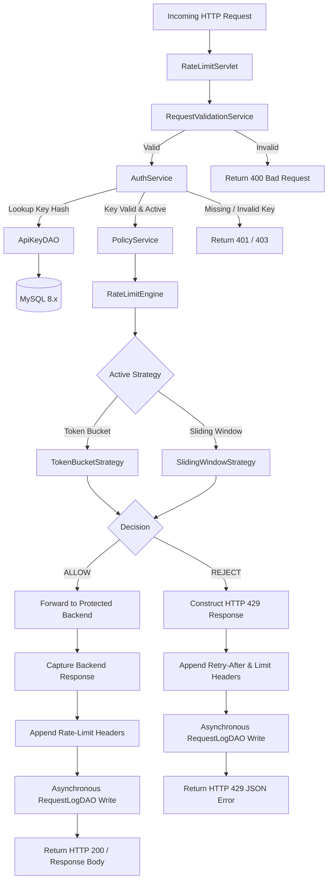

# System Architecture — Throttlix

## 1. Architectural Overview
**Throttlix** is engineered as a high-throughput, low-latency API traffic-control gateway. It sits directly in the ingress request path between external API consumers and protected downstream endpoints.

Its architectural design prioritizes deterministic execution, minimal processing overhead, thread-safe concurrency, and strict separation of concerns using **Core Java 21**, **Jakarta Servlets 6.0**, and **raw JDBC** hosted within **Apache Tomcat 10.1+**.

---

## 2. Architectural Style & Design Principles
- **Boundary Gateway Pattern:** Acts as the single point of entry for managed API traffic, enforcing policy before any business compute occurs.
- **Layered Architecture:** Enforces strict unidirectional dependencies across 4 layers:
  $$\text{Servlet / Controller} \longrightarrow \text{Business Service} \longrightarrow \text{DAO / Repository} \longrightarrow \text{MySQL 8.x}$$
- **Strategy Pattern:** Decouples the rate-limiting engine from concrete algorithm implementations via the `RateLimitStrategy` interface.
- **Framework-Free Core:** Deliberately eliminates Spring Boot, Spring MVC, and ORMs to prevent runtime overhead, hidden reflection, and magic annotations.

---

## 3. High-Level Architecture Diagram

```mermaid
flowchart LR
    subgraph External["External Layer"]
        Client[API Consumers / Mobile / Web]
        DashboardUser[Admin / Browser]
    end

    subgraph Runtime["Apache Tomcat 10.1+ Container"]
        ServletGateway["Jakarta Servlet Gateway\n(Throttlix Gateway)"]
        DashboardAPI["Analytics & Admin Servlets\n(/api/v1/analytics, /clients)"]
        
        subgraph CoreEngine["Core Business & Engine Services"]
            AuthService["Authentication Service\n(X-API-Key Validator)"]
            ValidationService["Request Validator"]
            RateLimitEngine["Rate Limiting Engine\n(Strategy Dispatcher)"]
            TokenBucket["TokenBucketStrategy\n(Atomic In-Memory)"]
            SlidingWindow["SlidingWindowStrategy\n(Timestamp Queue)"]
            LogService["Telemetry & Logging Service"]
        end
        
        subgraph DataAccess["JDBC Repository Layer"]
            KeyRepo["ApiKeyDAO"]
            PolicyRepo["PolicyDAO"]
            LogRepo["RequestLogDAO"]
        end
    end

    subgraph PersistentStore["Persistence Layer"]
        MySQL[(MySQL 8.x\nClients, Keys, Policies, Logs)]
    end

    subgraph TargetServices["Protected Infrastructure"]
        ProtectedAPI[Downstream Protected APIs\n(Target Services)]
    end

    Client -->|HTTP + X-API-Key| ServletGateway
    DashboardUser -->|React UI Dashboard| DashboardAPI

    ServletGateway --> AuthService
    ServletGateway --> ValidationService
    ServletGateway --> RateLimitEngine
    ServletGateway --> LogService
    
    RateLimitEngine --> TokenBucket
    RateLimitEngine --> SlidingWindow
    
    AuthService --> KeyRepo
    RateLimitEngine --> PolicyRepo
    LogService --> LogRepo
    DashboardAPI --> LogRepo
    
    KeyRepo --> MySQL
    PolicyRepo --> MySQL
    LogRepo --> MySQL
    
    ServletGateway -->|Allowed Traffic| ProtectedAPI
    ServletGateway -->|Rejected Traffic (429)| Client
```

---

## 4. Component Responsibilities & Lifecycle



---

## 5. Layered Architecture Details

| Layer | Primary Responsibilities | Package Location | Key Technologies |
| :--- | :--- | :--- | :--- |
| **Presentation / Servlets** | Handles HTTP requests, extracts headers (`X-API-Key`), maps JSON responses, assigns status codes. | `com.throttlix.controller` | Jakarta Servlet API 6.0, Jackson |
| **Service Layer** | Orchestrates authentication logic, validates request structure, resolves policies, and interfaces with the rate limiter. | `com.throttlix.service` | Pure Java 21 |
| **Rate Limiter Engine** | Implements concurrency-safe Token Bucket and Sliding Window algorithms; maintains fast in-memory counter states. | `com.throttlix.ratelimiter` | `ConcurrentHashMap`, `AtomicLong`, Java Collections |
| **Data Access (DAO)** | Performs parameterized SQL queries against MySQL for clients, keys, policies, and telemetry logs. | `com.throttlix.dao` | JDBC `PreparedStatement`, `Connection` |
| **Data Models (POJOs)** | Immutable domain entities, data transfer objects (DTOs), and configuration models. | `com.throttlix.model` | Java Records / POJOs |

---

## 6. Security Architecture
1. **API Key Storage:** Raw keys (e.g., `tk_live_...`) are generated using cryptographically secure random bytes (`SecureRandom`). Only their SHA-256 digests are stored in the database.
2. **Timing Attack Protection:** Hash comparisons during authentication use constant-time byte comparisons (`MessageDigest.isEqual()`).
3. **Defense Against SQL Injection:** Strict enforcement of JDBC `PreparedStatement` parameters across all queries.
4. **Sanitized Error Output:** Internal exception stack traces, database error codes, and server file paths are intercepted and replaced with uniform JSON error payloads.

---

## 7. Scalability & Future Evolution
- **Phase 1 (MVP - Current):** Single-instance in-memory state. Thread-safe `ConcurrentHashMap` instances hold bucket tokens and timestamp deques. Fast, simple, and self-contained.
- **Phase 2 (Post-MVP):** Distributed Redis integration. The `RateLimitStrategy` interface is implemented via a `RedisTokenBucketStrategy` utilizing atomic Redis Lua scripts, enabling multi-node Tomcat deployments sharing identical global counters.
