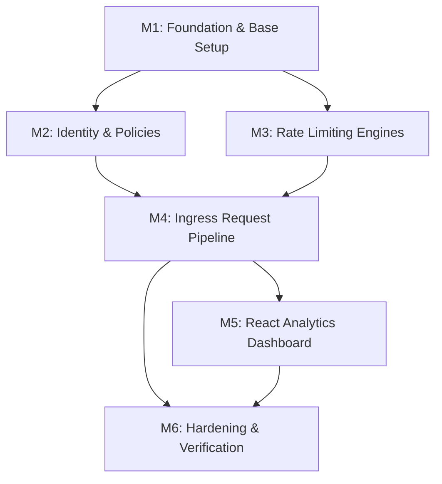

# Development Plan & Milestone Roadmap — Throttlix

## 1. Plan Overview
The development plan for **Throttlix** is structured into six focused, sequential milestones designed to deliver an operational Minimum Viable Product (MVP) within a 4-week development cycle.

---

## 2. Milestone Breakdown

| Milestone ID & Name | Objectives & Core Technologies | Deliverables & Artifacts | Verification Checklist |
| :--- | :--- | :--- | :--- |
| **M1: Foundation & Setup** | Project setup, Java web app, Tomcat container runtime, PostgreSQL connection, and Git workflow. *(Java 21, Tomcat 10.1, JDBC, Maven)* | - Clean package hierarchy - Database connection test (`HealthServlet`) - Root documentation suite | [x] Maven WAR builds successfully [x] PostgreSQL connectivity verified [x] Git branching rules active |
| **M2: Identity & Policies** | Client entity models, API key generation/hashing, policy configuration, and authentication service. *(Servlets, JDBC, PostgreSQL)* | - `ApiKeyDAO`, `PolicyDAO` - `AuthService`, `PolicyService` - Endpoints `/api/v1/clients`, `/api/v1/policies` | [ ] SHA-256 key hashing verified [ ] Unit tests for key lifecycle [ ] Client-policy association functional |
| **M3: Rate Engines** | Concurrency-safe algorithm implementations for Token Bucket and Sliding Window. *(Java Concurrency, Atomics)* | - `RateLimitStrategy` interface - `TokenBucketStrategy` - `SlidingWindowStrategy` | [ ] Multi-threaded concurrency tests pass [ ] Zero token double-spending under load [ ] Unit test coverage > 85% |
| **M4: Ingress Request Path** | Full gateway request pipeline integration: validation, auth, rate limit, backend proxy, telemetry logging, headers. *(Servlets, Jackson, JDBC)* | - `RateLimitServlet` / Gateway filter - Standard response headers generator - Protected `/api/v1/demo/orders` endpoint | [ ] HTTP 429 returned on quota breach [ ] Accurate `Retry-After` header verified [ ] Database audit log row inserted |
| **M5: Analytics Dashboard** | Interactive web dashboard consuming aggregated backend telemetry. *(React 19, TypeScript, Tailwind, Recharts)* | - React SPA frontend - KPI Summary cards - Time-series volume chart - Client usage ranking table | [ ] Frontend consumes `/analytics/summary` [ ] Zero TypeScript build errors [ ] Responsive UI across viewports |
| **M6: Hardening & Demo** | Comprehensive integration testing, performance benchmarking, documentation finalization, and demonstration script. *(Postman, JMeter/k6, GitHub)* | - Postman test collection - Concurrency benchmark report - Final release package & video script | [ ] End-to-end integration suite passes [ ] Clean repository state on `main` [ ] Complete demonstration recorded |

---

## 3. Dependency Graph Between Milestones

---

## 4. Phase Schedule & Target Timelines

| Phase | Duration | Focus Area | Primary Deliverable |
| :---: | :---: | :--- | :--- |
| **Week 1** | Days 1–7 | M1 (Foundation) & M2 (Identity & Policies) | Functional Key Generation & PostgreSQL DAOs |
| **Week 2** | Days 8–14 | M3 (Rate Limiting Engines) | Concurrency-Safe Token Bucket & Sliding Window |
| **Week 3** | Days 15–21 | M4 (Gateway Request Path) & M5 (Frontend UI) | End-to-End Rate Limiting with React Dashboard |
| **Week 4** | Days 22–28 | M6 (Hardening, Load Testing & Demo) | Stress Tests, Postman Collection & Release Package |
