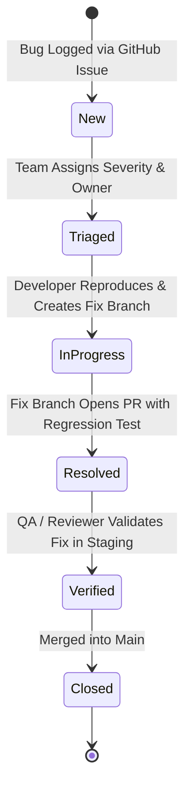

# Bug Reporting & Defect Triage — Throttlix

## 1. Overview
This document specifies the standard procedure for logging, categorizing, prioritizing, and resolving software defects identified across the **Throttlix** platform.

---

## 2. Defect Severity Matrix

| Severity Level | Definition & Operational Impact | Target SLA | Example Scenario |
| :--- | :--- | :---: | :--- |
| **P1 - Critical** | Catastrophic failure. Rate limiter fails to reject excess traffic; security breach; server crash; data corruption. | $< 4$ Hours | Concurrency defect causing double-token consumption under load; raw API key secrets exposed in logs. |
| **P2 - Major** | Major feature impaired with no workaround. Incorrect algorithm calculations; valid keys failing authentication. | $< 24$ Hours | Sliding window timestamp purge calculation off by an order of magnitude; database connection pool exhaustion. |
| **P3 - Moderate** | Feature functional with minor defect or workaround available; non-critical edge case failure. | 3–5 Days | Inaccurate `Retry-After` header value; dashboard chart fails to update on specific time ranges. |
| **P4 - Minor** | Cosmetic, formatting, or minor UI alignment issue. | Next Sprint | Misaligned table column in React dashboard; typo in error message string. |

---

## 3. Bug Lifecycle & Triage Workflow

---

## 4. Standard Defect Report Template
When opening an issue using the [Bug Report Template](../../.github/ISSUE_TEMPLATE/bug_report.md), provide:
1. **Title:** Concise summary prefixed with component (e.g., `[BUG][TokenBucket] Tokens not refilling after idle period`).
2. **Environment:** OS, JDK version, Tomcat version, PostgreSQL version.
3. **Preconditions & Configuration:** Relevant policy settings, active algorithm, request rate.
4. **Steps to Reproduce:** Exact cURL command or Postman script.
5. **Expected vs. Actual Outcome:** HTTP status code, returned headers, exception log.
6. **Regression Test:** Reference to the automated JUnit or Postman test case reproducing the defect.
