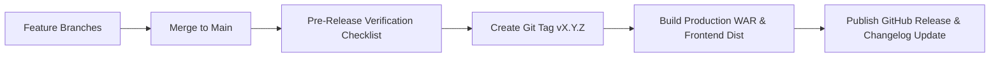

# Release Management & Versioning — Throttlix

## 1. Versioning Strategy
**Throttlix** adheres to [Semantic Versioning 2.0.0 (SemVer)](https://semver.org/):

$$\text{MAJOR}.\text{MINOR}.\text{PATCH}$$

- **MAJOR:** Incompatible API gateway changes, breaking configuration modifications, or structural database changes requiring manual migration.
- **MINOR:** Backward-compatible functionality additions (e.g., adding Sliding Window algorithm, new dashboard widget, new analytics endpoint).
- **PATCH:** Backward-compatible bug fixes, security patches, or performance optimizations.

---

## 2. Release Lifecycle & Process



### 2.1 Pre-Release Verification Checklist
Before tagging any release:
- [ ] All automated unit and concurrency tests pass cleanly (`mvn clean test`).
- [ ] Frontend builds with zero compiler errors (`npm run build`).
- [ ] Database migration script runs cleanly from scratch (`database/schema.sql`).
- [ ] All documentation files in `docs/` match the released codebase behavior.
- [ ] [CHANGELOG.md](../../CHANGELOG.md) is updated with all notable additions, fixes, and changes under the new version header.
- [ ] Health check endpoint (`/api/health`) reports `"status": "UP"`.

---

## 3. Git Release Tagging Procedure
Once `main` has been verified:
```bash
# 1. Update version in backend pom.xml (e.g. 1.0.0)
# 2. Commit version bump
git commit -am "chore(release): bump version to v1.0.0"

# 3. Tag the commit
git tag -a v1.0.0 -m "Release v1.0.0 — Throttlix Core MVP"

# 4. Push commit and tag to remote
git push origin main --tags
```
