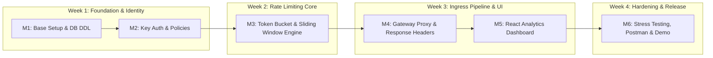

# Project Roadmap & Release Schedule — Throttlix

## 1. Executive Roadmap Overview
The **Throttlix** project executes across a 4-week timeline covering 6 clearly defined milestones from initial foundation setup to production hardening and final demonstration.

---

## 2. Visual Timeline Roadmap

---

## 3. Milestone Delivery Schedule

### Week 1: Foundation & Identity (Days 1–7)
- **M1 Deliverable:** Project directory structure, Maven WAR packaging, Jakarta Servlets 6.0 setup, PostgreSQL schema DDL (`schema.sql`), and root documentation framework.
- **M2 Deliverable:** `ApiKeyDAO`, `PolicyDAO`, SHA-256 key generation and verification, and administrative client creation endpoints.
- **Exit Gate:** Clean compilation of backend WAR; successful PostgreSQL DDL deployment; Health servlet responding with `status: UP`.

### Week 2: Rate Limiting Engines (Days 8–14)
- **M3 Deliverable:** `RateLimitStrategy` interface, thread-safe `TokenBucketStrategy` with continuous refill, and `SlidingWindowStrategy` with timestamp deque.
- **Exit Gate:** Concurrency stress test passes with zero double-token spending under 50 simultaneous threads. Unit test coverage $\ge 85\%$.

### Week 3: Ingress Pipeline & Observability (Days 15–21)
- **M4 Deliverable:** Servlet gateway filter intercepting requests, validating keys, evaluating limits, forwarding allowed calls, constructing HTTP 429 responses, and populating `X-RateLimit-*` headers.
- **M5 Deliverable:** React 19 + TypeScript dashboard displaying KPI metric cards, Recharts time-series charts, and client usage tables.
- **Exit Gate:** End-to-end curl and browser calls to `/api/v1/demo/orders` demonstrate rate limiting and live updates on the dashboard.

### Week 4: Hardening, Benchmarking & Demo (Days 22–28)
- **M6 Deliverable:** Postman automated API test collection, JMeter/k6 load test results, final documentation freeze, and scripted demonstration video/presentation.
- **Exit Gate:** Stable `v1.0.0` release tagged on GitHub `main` branch.
